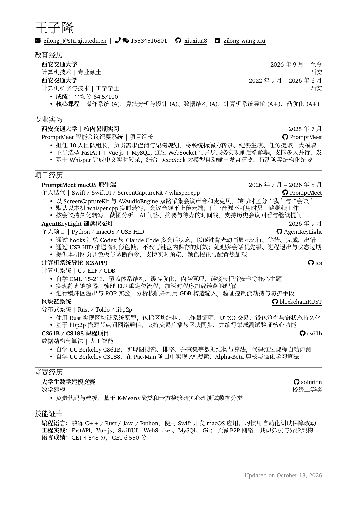

# 王子隆的简历

[](resume-cn.pdf)

[查看 / 下载 PDF](resume-cn.pdf)

## 修改与编译

简历源文件是 [`resume-cn.tex`](resume-cn.tex)，排版样式在 [`cv.cls`](cv.cls)。修改后在仓库根目录运行：

```bash
make
```

它会依次完成：

1. 用 XeLaTeX 编译出 `resume-cn.pdf`
2. 检查简历是否为 1 页，超出时报错
3. 用 `pdftoppm` 生成本页展示的预览图 `preview/resume-cn.png`

依赖：TeX Live / MacTeX（`xelatex`）和 Poppler（`pdftoppm`、`pdfinfo`，macOS 可用 `brew install poppler` 安装）。字体都在 `fonts/` 目录中，不需要额外安装。

提交时请把 `resume-cn.tex`、`resume-cn.pdf` 和 `preview/resume-cn.png` 一起提交，保证仓库首页展示的就是最新版本。

## 文件结构

| 路径 | 说明 |
| --- | --- |
| `resume-cn.tex` | 中文简历内容 |
| `cv.cls` | 文档类：版式、字体和 `\cventry` 等自定义命令 |
| `fonts/` | Avenir Next（标题）与思源宋体（中文正文） |
| `resume-cn.pdf` | 编译结果 |
| `preview/resume-cn.png` | README 中展示的预览图 |
| `AGENTS.md` | 给 AI agent 的维护说明 |

## 致谢

模板来自 [matchy233/chi-cv-template](https://github.com/matchy233/chi-cv-template)，仿照 [Alex Chi Zhang](https://github.com/skyzh) 的简历设计，以 MIT 协议发布，见 [LICENSE](LICENSE)。
